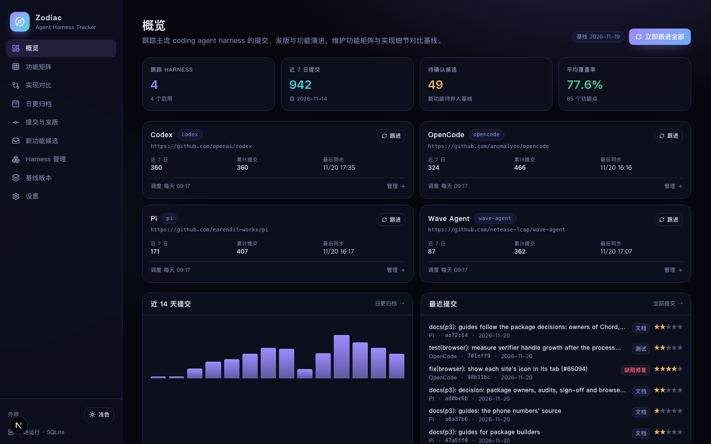
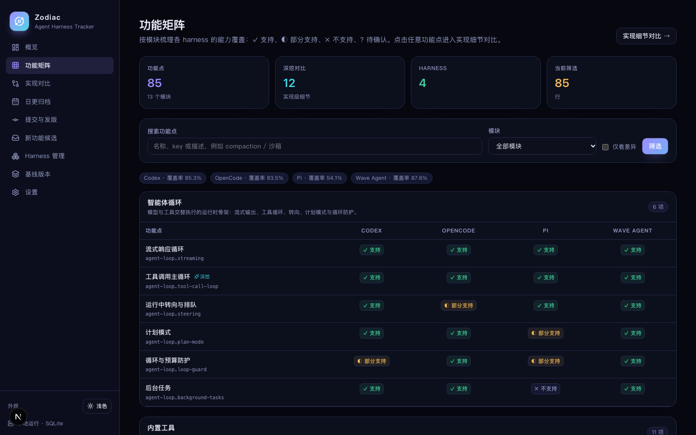
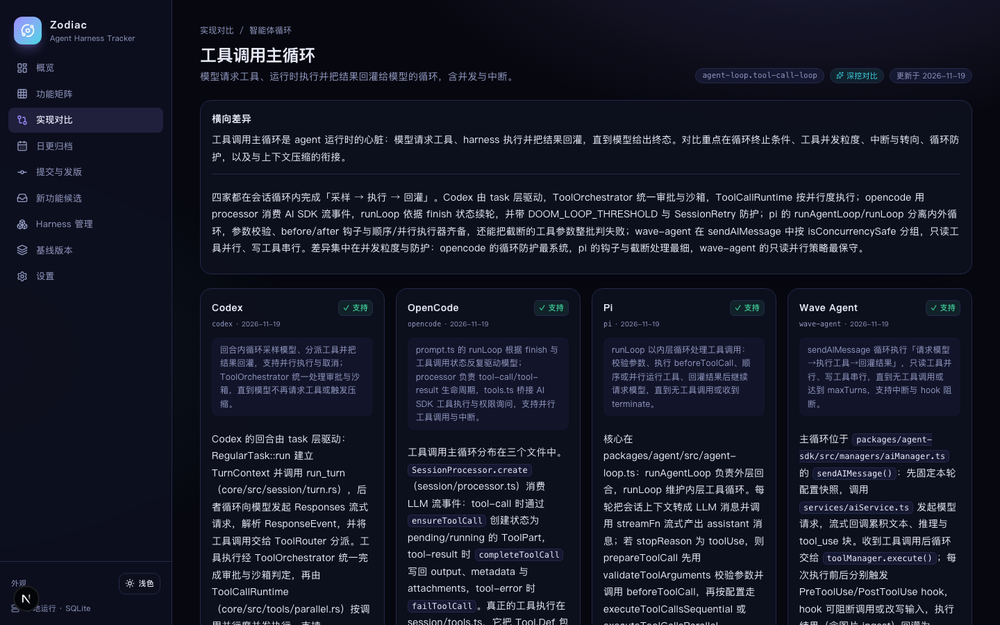
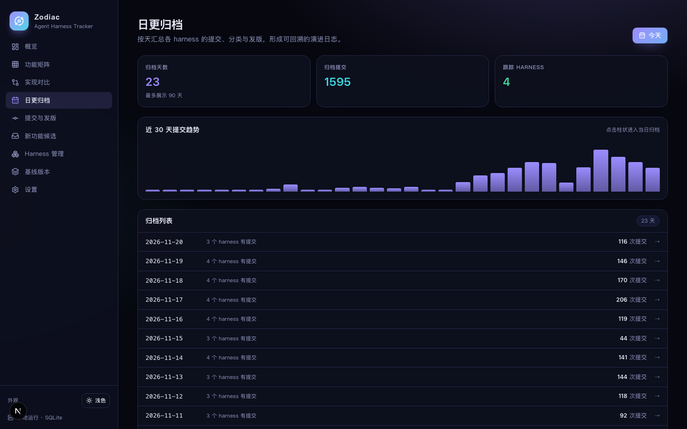
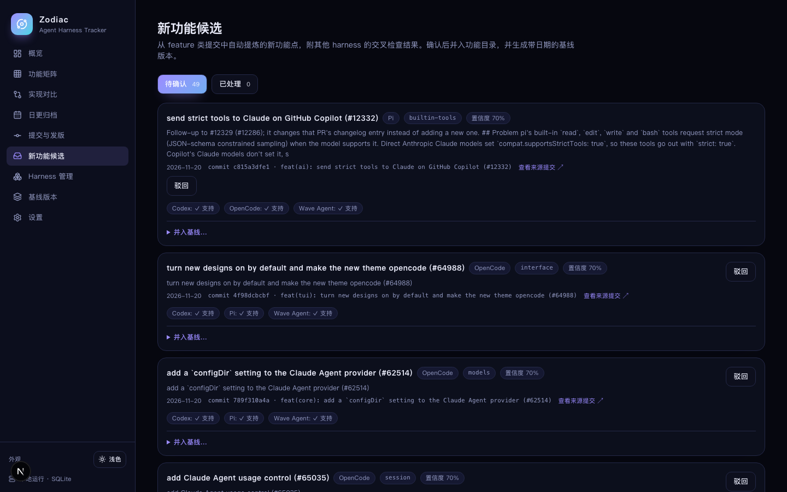

# Zodiac — Coding Agent Harness 追踪与对比

持续跟踪主流 coding agent harness 的提交与发版，自动分类、代码解读式评审、评级并按天归档；同时维护一份可演进的「功能矩阵 + 实现细节对比」基线。首批跟踪 **Codex、OpenCode、Pi、Wave Agent** 四个仓库。



> 完整的逐页操作说明见 [docs/usage.md](docs/usage.md)（含各页面截图）。
>
> 版本迭代与功能变更时间线见 [CHANGELOG.md](CHANGELOG.md)，每次提交做了什么都在这里。

## 功能

- **功能矩阵**：13 个模块、85 个功能点，按 ✓ / ◐ / ✗ / ? 标注各 harness 的支持状态，支持搜索、模块筛选与「仅看差异」。
- **实现细节对比**：12 个核心功能（主循环、文件编辑、沙箱、系统提示、压缩、记忆、会话持久化、Provider、TUI、插件、MCP stdio、子智能体）逐项对比实现方式，附源码证据路径、横向差异总结与更新时间线。对比页支持**按功能点 AI 重审**：模型读取各 harness 的代码快照，重新判断支持状态、整理实现细节与横向差异，直接写入功能矩阵并生成可回滚的基线版本；引擎优先 Anthropic API，回退所选本地引擎（Claude Code / Codex / DeepSeek Harness），证据中的 `path:line` 会回到镜像逐一验证。重审成功的功能点会自动加入深挖集合，也可在对比页手动「设为深挖 / 取消深挖」。
- **提交与发版跟踪**：bare git mirror 抓取提交，GitHub Releases API（失败回退 tags）；手动「立即跟进」或按 harness 配置每小时/每天自动同步。
- **自动分析**：启发式分类（feature / performance / bugfix / refactor / docs / test / tooling / other）、1–5 星评级、代码解读式中文评审（解决的问题 / 具体改动 / 实现解读 / 影响与风险，通常 300–600 字，聚焦实现思路、步骤与关键函数）与功能标签；分析引擎自动选择：优先 Anthropic API，未配置或失败时回退所选本地引擎（Claude Code / Codex / DeepSeek Harness），再失败回退启发式。评级依据功能重要性、影响面与风险，不按改动行数加分。
- **按天归档**：每个 harness 每天聚合提交、分类统计、发版记录与重点点评。
- **基线演进**：人工编辑支持状态或确认新功能候选后，自动生成带日期的基线版本与功能历史，可导出 JSON / Markdown。
- **新功能候选**：从 feature 类提交中提炼候选，自动对其它 harness 做目录相似度与提交历史交叉检查，人工接受或驳回。
- **功能探索**：输入一个命题，由 AI 通过只读工具自主浏览所选 harness 的本地镜像，整理每个 harness 的完整实现方案，并在多个 harness 之间横向对比，生成以分析为主、可溯源到 `path:line` 的报告并保存。引擎可在设置中四选一：Anthropic API（应用内工具循环）、本地 Claude Code CLI、本地 Codex CLI 或本地 DeepSeek Harness（均为只读模式 + 临时 worktree 快照，复用本地登录态）；AI 不可用或调用失败时回退到离线关键词检索 + Claude 综合/启发式报告。代码片段默认折叠在详情页「代码证据」中。

## 界面预览

| 功能矩阵                                      | 实现细节对比                                                    |
| --------------------------------------------- | --------------------------------------------------------------- |
|  |  |
| **日更归档**                                  | **新功能候选**                                                  |
|     |                |

更多截图与逐页操作说明见 [docs/usage.md](docs/usage.md)。

## 技术栈

Next.js 16（App Router）+ React 19 + TypeScript + Tailwind CSS 4，SQLite（better-sqlite3，WAL），Zod 校验，Biome 格式化与检查，Vitest + Playwright 测试，可选 Anthropic SDK。

## 快速开始

```bash
pnpm install
pnpm seed        # 导入 seed/baseline.json（4 个 harness、85 个功能点、48 段实现细节）
pnpm dev         # http://localhost:3000
```

首次同步可在「Harness 管理」页点击「同步」，或：

```bash
pnpm sync --all             # 抓取全部启用的 harness
pnpm sync --harness codex   # 只同步 codex
```

同步会在 `data/` 下创建 bare mirror（浅克隆，仅跟踪配置的分支）与按需落盘的 diff。首次全量抓取耗时取决于仓库大小与回填天数。

## 环境变量

| 变量                  | 说明                              | 默认               |
| --------------------- | --------------------------------- | ------------------ |
| `ZODIAC_DATA_DIR`     | mirror、diff、数据库所在目录      | `./data`           |
| `ZODIAC_DB_PATH`      | 直接指定 SQLite 文件路径          | `data/zodiac.db`   |
| `ZODIAC_TZ`           | 按天归档所用时区                  | `Asia/Shanghai`    |
| `ZODIAC_SCHEDULER`    | 设为 `off` 关闭应用内调度器       | 开启               |
| `ZODIAC_LOCAL_ENGINE` | 设为 `off` 禁用全部本地 AI 引擎   | 开启               |
| `ZODIAC_LOCAL_CLAUDE` | 设为 `off` 只禁用本地 Claude Code | 开启               |
| `ANTHROPIC_API_KEY`   | 启用 Claude 增强分析              | 未设置（仅启发式） |
| `ANTHROPIC_MODEL`     | Claude 模型 ID                    | `claude-sonnet-5`  |
| `GITHUB_TOKEN`        | Releases API 鉴权，降低限流       | 未设置             |

密钥只从环境变量读取，不会写入数据库或页面。

## 目录结构

```
src/app/                # 页面与 API 路由（概览、矩阵、对比、探索、日报、提交、候选、Harness、基线、设置）
src/components/         # AppShell、矩阵、对比、Markdown、Diff、同步按钮、探索表单等组件
src/lib/db/             # schema/migrations + repositories（harness、commit、catalog、candidate、exploration…）
src/lib/git/            # bare mirror、git log/numstat/patch 解析、本地 grep 检索、Releases、diff 落盘
src/lib/ingest/         # 一次同步的完整流程：抓取 → 入库 → 分析 → 日报 → 候选交叉检查
src/lib/analysis/       # 分类、评级、启发式摘要、功能识别、可选 Claude 增强
src/lib/explore/        # 功能探索：AI 工具循环、离线检索回退、证据与报告组装
src/lib/localEngine/    # 本地引擎适配：Claude Code / Codex / DeepSeek Harness 的无头调用与探活
src/lib/git/snapshot.ts # 只读临时 worktree 快照（供本地引擎探索与重审）
src/lib/catalog/        # 矩阵、对比视图、基线版本、候选并入、Markdown 导出
src/lib/scheduler/      # 60s tick 的到期判断与防重入调度
src/lib/http/           # 统一响应封装、同源校验、限流
scripts/                # seed / sync / build-baseline
seed/                   # taxonomy 与基线数据（parts 为逐仓库分析结果）
tests/                  # unit / integration / e2e
```

## 数据流程

1. `ensureMirror` 对每个 harness 维护一个 bare mirror，后续 `git fetch --prune --tags`。
2. 读取 `lastSha..HEAD` 范围内的提交（首次按 `backfillDays`），抓取 message、文件列表，再对近期提交抓取 numstat 与截断后的 diff。
3. Releases 读取 GitHub API，无 token 或失败时回退到 git tags。
4. 逐提交分类、评级、生成中文摘要与功能标签；对 feature 类提交生成新功能候选。
5. 重建受影响日期的日报，记录 `sync_runs` 状态。
6. 候选的交叉检查结果落在 `candidate_checks`，人工确认后写入 `feature_support` / `feature_history` 并生成新的 `catalog_versions`。

所有 git 命令通过 `execFile` 参数数组执行，仓库地址、分支与证据路径均经过校验；Markdown 默认不渲染原始 HTML。

## 更新基线数据

`seed/parts/*.json` 保存每个 harness 在某一日期的完整功能判定（状态、备注、证据路径、实现细节）。修改后重新生成并导入：

```bash
pnpm build-baseline   # 校验 85 个 key 齐全后合并为 seed/baseline.json（deep dive 摘要见 seed/parts/_deepdives.json）
pnpm seed             # 幂等导入，功能内容变化会生成新的基线版本
```

分析规则调整后，可用 `pnpm reanalyze` 以最新的启发式规则重算已有提交（分类、评级、摘要、候选）：

```bash
pnpm reanalyze --reset-candidates   # 先清空待审候选，再重算全部提交
pnpm reanalyze --harness codex      # 只重算某个 harness
```

## 测试

```bash
pnpm lint        # Biome（格式 + 规则）
pnpm typecheck
pnpm test        # Vitest，336 个用例，src/lib 覆盖率门槛 80%
pnpm e2e         # Playwright，首次运行前执行 pnpm exec playwright install chromium
```

集成测试会用临时 git 仓库跑完整的「mirror → 抓取 → 分析 → 日报/候选」链路，不访问网络。

## 安全与部署

默认面向本机使用：所有写操作 API 都会校验同源并限流，服务应只监听 localhost。若需要公网访问，请在反向代理层增加身份认证与 HTTPS。

## 后续计划（TBD）

以下方向尚未实现或只做了雏形，按需排期，完成一项就在 [CHANGELOG.md](CHANGELOG.md) 记一笔。

- [ ] **更多 harness**：接入 Cursor、Gemini CLI、Cline 等，并支持在页面新增自定义仓库。
- [ ] **任务队列**：AI 重审与功能探索目前是进程内后台任务，补上排队、并发上限、取消与失败重试；重启后未完成任务的状态恢复。
- [ ] **多模型评审**：提交评审支持按模型对比结果，并允许人工修订后保存。
- [ ] **基线版本差异**：在「基线版本」页直接对比任意两个版本的逐字段变化，而不只是查看快照。
- [ ] **导出增强**：功能矩阵与对比报告导出 PDF / PNG / CSV；探索报告支持一键复制为 Markdown。
- [ ] **探索缓存**：同一个命题重复检索时复用证据，减少大仓库的检索耗时。
- [ ] **通知**：同步完成、AI 重审完成或失败时，通过桌面通知 / Webhook 提醒。
- [ ] **部署**：提供 Docker 镜像与一键部署脚本；可选的多用户只读分享链接与接入鉴权。
- [ ] **窄屏适配**：矩阵与对比页在平板 / 手机上的布局优化。
- [ ] **自动 changelog**：按提交类型与标签自动生成条目，随 Release 一起发布。

## License

私有项目，暂未指定开源许可证。
