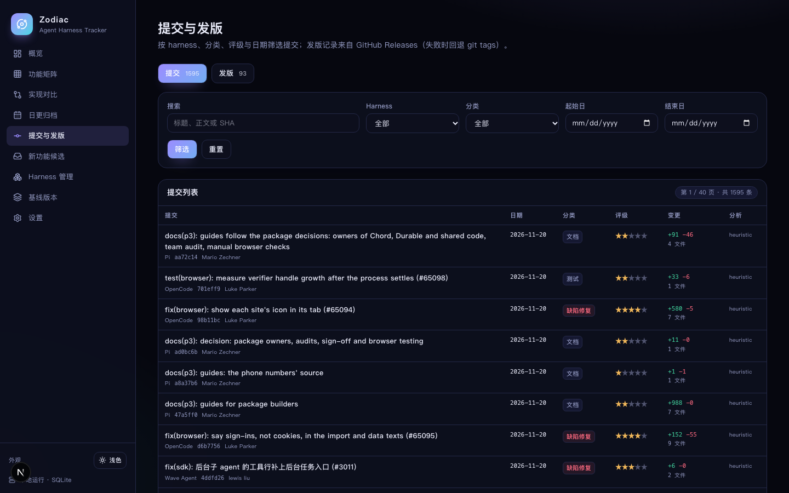
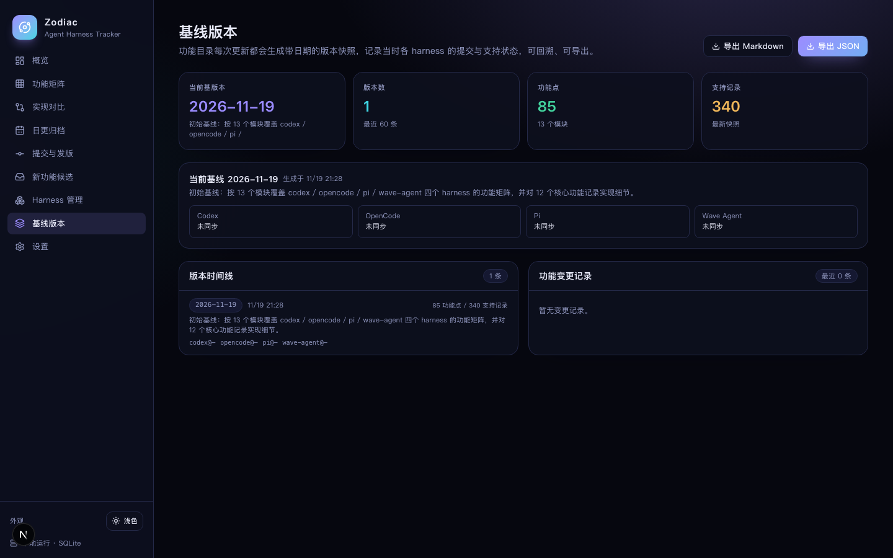
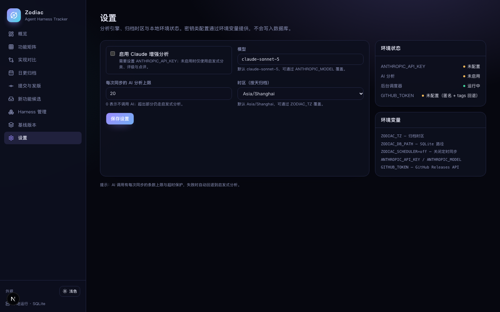

# Zodiac 功能使用指南

Zodiac 用来持续跟踪主流 coding agent harness（Codex、OpenCode、Pi、Wave Agent）的提交与发版，并把「功能矩阵 + 实现细节对比」沉淀成可回溯、可导出的基线。

本文按页面逐一说明每个功能怎么用、每个状态是什么意思。文中的截图均来自本地示例库（深色主题，数据截至 2026-11-20）。

## 目录

- [1. 快速上手](#1-快速上手)
- [2. 概览](#2-概览)
- [3. 功能矩阵](#3-功能矩阵)
- [4. 实现细节对比](#4-实现细节对比)
- [5. 日更归档](#5-日更归档)
- [6. 提交与发版](#6-提交与发版)
- [7. 新功能候选](#7-新功能候选)
- [8. Harness 管理](#8-harness-管理)
- [9. 基线版本](#9-基线版本)
- [10. 设置](#10-设置)
- [11. 同步机制与运行状态](#11-同步机制与运行状态)
- [12. 常见问题](#12-常见问题)
- [附录：常用命令](#附录常用命令)

---

## 1. 快速上手

```bash
pnpm install
pnpm seed     # 导入 seed/baseline.json：4 个 harness、85 个功能点、48 段实现细节
pnpm dev      # http://localhost:3000
```

打开页面后，数据来自本地 SQLite（`data/zodiac.db`）。

**第一次同步**有两种方式：

1. 打开「Harness 管理」页，在任一 harness 卡片上点「同步」；或在概览页点「立即跟进全部」。
2. 命令行：`pnpm sync --all`，或 `pnpm sync --harness codex`。

首次同步会为每个仓库创建 bare mirror 并按「回填天数」拉取历史提交，仓库越大耗时越长。后续同步只增量抓取 `lastSha..HEAD`。

**自动同步**由应用内调度器完成（每 60 秒检查一次到期情况）：在 Harness 管理里把调度设为「每小时」或「每天 HH:MM」即可。设置 `ZODIAC_SCHEDULER=off` 可完全关闭自动同步。

---

## 2. 概览


概览页是每天打开系统时的入口。

**顶部指标卡**：跟踪的 harness 数（含启用数）、近 7 日提交数、待确认的新功能候选数、平均功能覆盖率。

**Harness 卡片**（每个仓库一张）：显示仓库地址、近 7 日与累计提交、最后同步时间、调度配置与最近一次错误。

- 「跟进」按钮只同步这一个 harness。同步期间按钮变为「同步中…」，完成后显示「已完成」，失败显示「重试」。
- 若该 harness 正在同步（包括其它页面/进程触发的），卡片上会出现「排队中/同步中」标签，「最后同步」替换为「本次同步 · 进行中…」。
- 点「管理 →」跳转到该 harness 的配置。

**「立即跟进全部」**：一次同步所有启用的 harness。按钮会按每个 run 的实时状态轮询，全部结束后自动刷新页面数据。

**下方区块**：

- 「近 14 天提交」柱状图，每根柱子可点进对应日期的日报。
- 「最近提交」和「最近发版」，点标题进入提交详情；发版来自 GitHub Releases（失败回退到 git tags）。
- 「同步运行」列出最近 6 次同步的状态、触发来源、阶段与新增数量。

没有任何数据时，页面会提示去 Harness 管理或运行 `pnpm seed`。

---

## 3. 功能矩阵


按模块（13 个）维护 85 个功能点在各 harness 上的支持状态。

**状态图例**：

| 标记 | 含义 |
| ---- | ---- |
| ✓ 支持 | 已实现且行为完整 |
| ◐ 部分支持 | 部分实现、有条件支持或实现有限 |
| ✗ 不支持 | 明确未实现 |
| ? 待确认 | 尚未核实 |

**筛选**（通过 URL 参数，可收藏/分享）：

- 搜索框：匹配功能点名称、key 或描述，例如 `compaction`、`沙箱`。
- 模块下拉：只看某个模块。
- 「仅看差异」：只保留各 harness 状态不完全一致的行，快速定位差异化能力。
- 「筛选」重新提交查询，右上角「当前筛选」会显示命中行数。

**覆盖度标签**：筛选结果上方显示每个 harness 的覆盖率（支持 + 部分支持的占比）。

**进入对比**：点击功能点名称（或任一状态徽标）进入该功能的实现细节对比页；标有「深挖」的是 12 个有实现级对比的核心功能。

---

## 4. 实现细节对比

### 4.1 对比索引


按模块汇总所有功能点，一行一个功能点、一列一个 harness，悬停状态徽标可看到该 harness 的备注。点击整行进入详情。

### 4.2 单个功能对比


- **横向差异**：该功能的总览与各 harness 差异总结（Markdown 渲染）。
- **每个 harness 一张卡**：支持状态、更新日期、支持说明、实现细节、源码「证据」路径。支持状态徽标可点击跳到 Harness 管理的对应仓库。
- **编辑支持状态**（折叠区）：选择 harness、状态、备注与证据路径，保存后会立即生成一个带日期的基线版本。这里也是人工校正自动分析结果的地方。
- **变更时间线**：该功能的历史变更记录。
- **上一/下一功能点**：按目录顺序浏览。

> 支持状态由人工确认后写入 `feature_support`，每次保存都会产生新基线版本。

---

## 5. 日更归档


把每天的提交、分类统计与发版聚合成可回溯的日报。

- 顶部统计：归档天数（最多展示 90 天）、归档提交总数、跟踪的 harness 数。
- 「今天」直接跳到当天日报。
- 「近 30 天提交趋势」：点击柱子进入当天日报。
- 归档列表：每天的提交数，以及有几个 harness 当天有提交。

### 5.1 某一天的日报


- 每个 harness 一个区块：分类计数标签（如「功能迭代 3」「缺陷修复 5」）、自动生成的日报摘要、当日提交明细（点标题进提交详情）。
- 「当日发版」列出当天发布的版本。
- 顶部「前一/后一天」可连续浏览。
- 日报会在每次同步后自动重建，不需要手动维护。

---

## 6. 提交与发版



页签分为「提交」和「发版」。

**提交页签**

- 筛选：标题/正文/SHA 搜索、Harness、分类（功能迭代、性能优化、缺陷修复、重构整理、文档、测试、工程与工具、其他）、起止日期；「重置」清空筛选。
- 列表每页 40 条，显示分类、1–5 星评级、增删行数、文件数与分析引擎（`heuristic` 或 AI）。
- 未分析的提交分类显示为「未分析」。

**发版页签**

- 最近 100 条发版记录，含 tag、名称、发布日期与外链；有正文时可展开查看 Markdown 说明。

### 6.1 提交详情


- 顶部「GitHub」外链到原始提交；「重新分析」会用当前规则重新生成分类、评级、点评（配置了 AI 时优先使用 AI，失败回退启发式）。
- 四张卡：分类、评级、变更规模、分析引擎与时间。
- 「点评」：中文摘要与评级理由。
- 「代码变更」：标注统计是否完整；diff 超过 1500 行会截断显示。
- 侧栏：文件列表（状态与增删）、功能标签、仓库信息（分支、SHA、提交时间）。

---

## 7. 新功能候选


同步时，系统会从 feature 类提交中提炼「新功能候选」，并对其它 harness 做交叉检查（目录相似度 + 提交历史）。人工确认后才会进入功能矩阵与基线。

**候选卡片**：标题、来源 harness、模块、置信度、描述、创建日期、来源提交链接，以及其它 harness 的交叉检查结果（例如「Codex: ✓ 支持」）。

- **驳回**：直接丢弃该候选（无二次确认）。
- **并入基线…**（展开）：
  1. 功能点 key（默认 `模块key.slug`，必须符合 `模块.功能` 形式）；
  2. 名称；
  3. 模块；
  4. 每个 harness 的支持状态（默认取交叉检查结果，来源 harness 默认 ✓，其余默认 ?）；
  5. 写入来源 harness 支持说明的备注。
- 点「确认并入基线」后，至少要为 1 个 harness 选择非「?」状态。成功后提示新的基线版本号，候选移到「已处理」。

---

## 8. Harness 管理


管理被跟踪的仓库及其调度配置。页头显示调度器是否运行和当前时区。

**卡片操作**：

- 「同步」：立即同步该仓库，并轮询显示进度；完成后提示新增提交数。
- 「停用/启用」：不删除数据，只停止自动同步。
- 垃圾桶按钮：删除 harness，会级联删除提交、发版、同步记录、候选与支持记录，并清理本地镜像。有确认框，不可撤销。

**编辑配置**（折叠区）：

| 字段 | 说明 |
| ---- | ---- |
| 名称 | 显示名 |
| 仓库地址 | 支持 https / git / ssh 的 owner/repo |
| 分支 | 默认 `main` |
| 调度 | 关闭 / 每小时 / 每天 |
| 每日时刻 | 调度为「每天」时的时间（如 09:17） |
| 回填天数 | 1–3650，首次同步向前抓取的范围 |
| 排序 | 概览与列表中的展示顺序 |

**调度规则**：

- 关闭：不自动同步。
- 每小时：距上次尝试满 55 分钟即到期。
- 每天：在配置时区的每日时刻之后、且当天尚未尝试过时到期。

由于判断依据是「上次尝试开始时间」而不是完成时间，一次很长的同步不会被重复触发。

**最近同步记录**（折叠区）：每次同步的状态、开始时间、触发来源（`manual`/`schedule`/`cli`）、阶段与新增数量，失败时显示错误信息，是排查问题的第一入口。

**添加 Harness**：表单填 slug、名称、仓库地址、分支、调度、每日时刻与回填天数（默认 30），点「添加 Harness」。

### 8.1 同步进行中


同步开始后，按钮进入「同步中…」并禁用；进度通过每 2 秒一次的状态查询更新。刷新页面不会丢掉进度：服务端会把正在运行的 run 交给按钮，重新挂载后继续轮询。

---

## 9. 基线版本



功能目录的每次变更都会生成一个带日期、不可变的快照。

- **统计卡**：当前基线版本号、版本总数、功能点数、支持记录数。
- **当前基线**：生成时间、版本说明，以及当时各 harness 的提交 SHA（未同步显示「未同步」）。
- **版本时间线**：最近 60 个版本及其功能点/支持记录数量、说明与各仓库 SHA。
- **功能变更记录**：最近 40 条功能状态变更，可点进对比页。

**版本号规则**：以日期 `YYYY-MM-DD` 命名；同一天多次变更依次为 `YYYY-MM-DD-2`、`YYYY-MM-DD-3`……

**导出**：

- 「导出 Markdown」→ `GET /api/baseline/export?format=md`，下载 `zodiac-baseline-{day}.md`。
- 「导出 JSON」→ `GET /api/baseline/export`，下载 `zodiac-baseline-{day}.json`，包含 modules / features / support 完整快照、生成时间与各 harness SHA。

---

## 10. 设置



**可编辑项**：

| 设置 | 说明 |
| ---- | ---- |
| 启用 Claude 增强分析 | 需要配置 `ANTHROPIC_API_KEY`；关闭时仅使用启发式分析 |
| 模型 | 默认 `claude-sonnet-5`，可被环境变量 `ANTHROPIC_MODEL` 或此处保存值覆盖 |
| 每次同步的 AI 分析上限 | 0–200，默认 20；0 表示不调用 AI，超出部分仍走启发式 |
| 时区（按天归档） | 影响按天归档与每日调度；保存后写入数据库并作用于当前进程 |

AI 调用有单次同步的条数上限与超时保护，失败会自动回退启发式分析，不会中断同步。

**右侧「环境状态」**：直观显示 `ANTHROPIC_API_KEY`、AI 分析、后台调度器、`GITHUB_TOKEN` 的配置情况。

**只能通过环境变量控制的项**：

- `ZODIAC_SCHEDULER=off`：关闭应用内调度器（表单里没有开关）。
- `ZODIAC_DB_PATH`：SQLite 文件位置。
- `ZODIAC_TZ`：默认归档时区（表单修改只在当前进程生效，重启后以环境变量为准）。

密钥只从环境变量读取，不会写入数据库或页面。

---

## 11. 同步机制与运行状态

一次同步分为两个阶段：

1. **预约**：先创建一条运行中的 run 记录并立刻返回 run id，页面可以马上开始轮询。
2. **执行**：抓取 → 入库 → 分析 → 重建日报 → 候选交叉检查，阶段依次为 `fetch` → `ingest` → `analyze` → `finalize` → `done`。

运行期间：

- 每次阶段切换都会更新状态；同时每 30 秒刷新一次心跳，用来区分「还在跑」和「进程已退出」。
- 进程崩溃或重启后留下的运行记录，只有心跳超过 5 分钟未更新才会被回收为失败；应用不会把正常的长同步误判为孤儿。
- 同一个 harness 同时只会有一个运行中的同步；重复触发会返回「已有同步正在进行」并附上现有 run 的 id。

**触发来源**：手动（页面按钮）、定时（调度器）、命令行（`pnpm sync`）。

---

## 12. 常见问题

**首次同步很慢？**
首次会按回填天数拉取历史提交并逐条分析，取决于仓库大小与网络。之后是增量同步。

**同步失败怎么看原因？**
打开 Harness 管理 →「最近同步记录」查看错误信息；卡片上的红色错误条也会显示最近一次失败。常见原因是网络中断导致 `git fetch` 失败，重新点「同步」即可。

**发版列表为空 / 提示 GitHub API 403？**
未配置 `GITHUB_TOKEN` 时使用匿名访问，容易触发限流。系统会自动回退到 git tags；配置 token 后重启即可恢复 Releases 数据。

**想重算历史提交的分析结果？**

```bash
pnpm reanalyze                  # 用最新启发式规则重算全部提交
pnpm reanalyze --harness codex  # 只重算某个 harness
pnpm reanalyze --reset-candidates  # 先清空待审候选再重算
```

**数据存在哪里？**
SQLite 在 `data/zodiac.db`，bare mirror 在 `data/mirrors/`，按需落盘的 diff 在 `data/diffs/`。这些目录默认被 git 忽略。

**Markdown 会执行 HTML 吗？**
不会。点评、日报与对比内容默认不渲染原始 HTML。

---

## 附录：常用命令

```bash
pnpm dev                    # 开发服务器
pnpm build && pnpm start    # 生产构建
pnpm sync --all             # 同步全部启用的 harness
pnpm sync --harness codex   # 同步单个 harness
pnpm seed                   # 导入基线数据
pnpm build-baseline         # 由 seed/parts/*.json 重新生成 seed/baseline.json
pnpm reanalyze              # 重算历史分析
pnpm lint / pnpm typecheck / pnpm test / pnpm e2e
```
