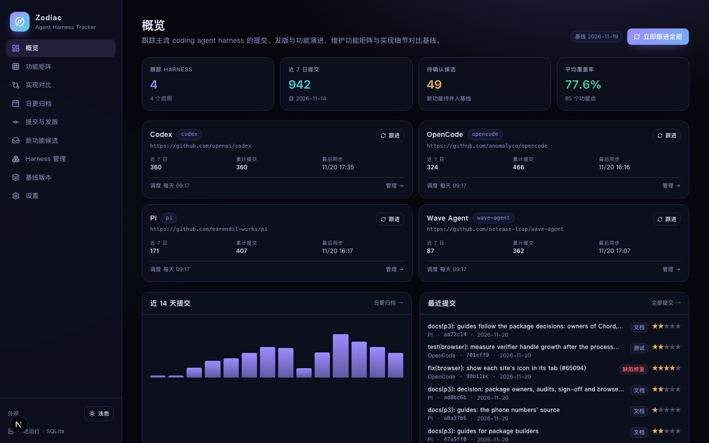
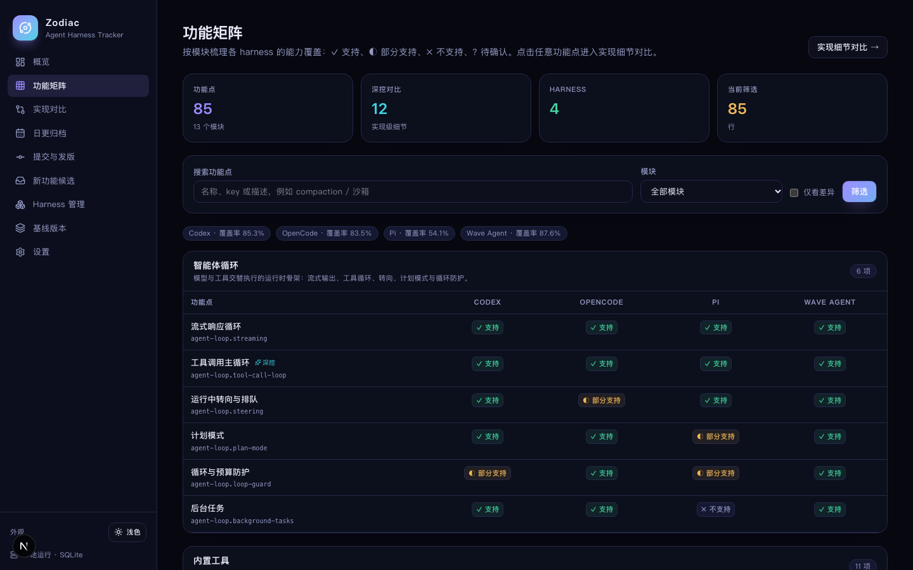
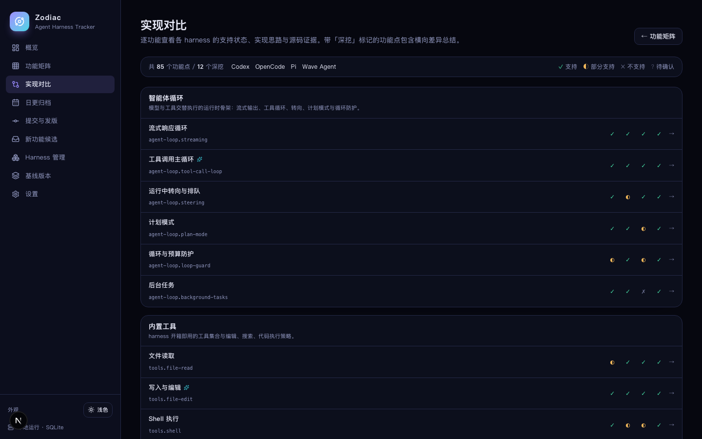
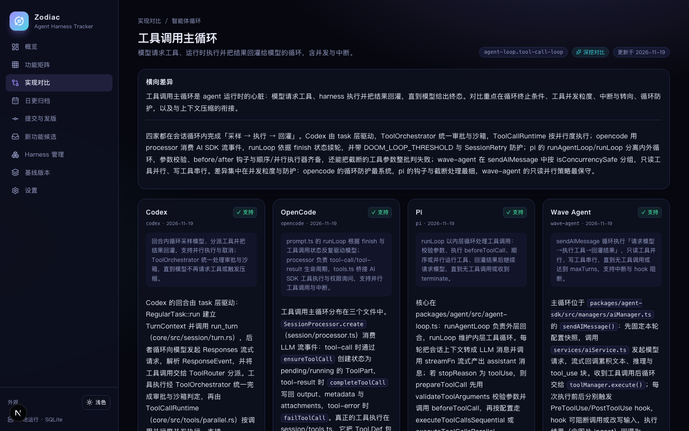
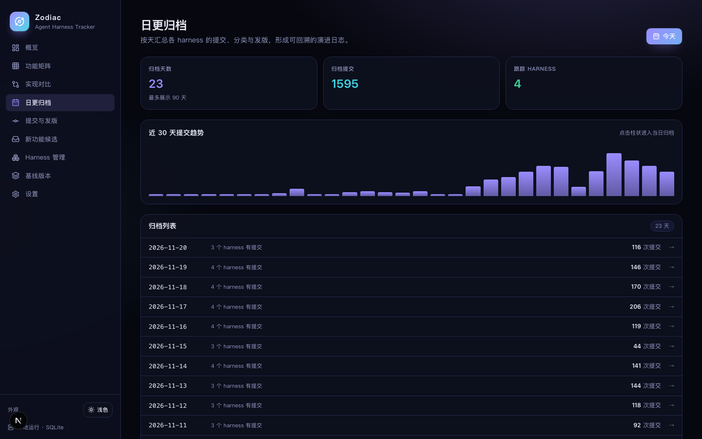
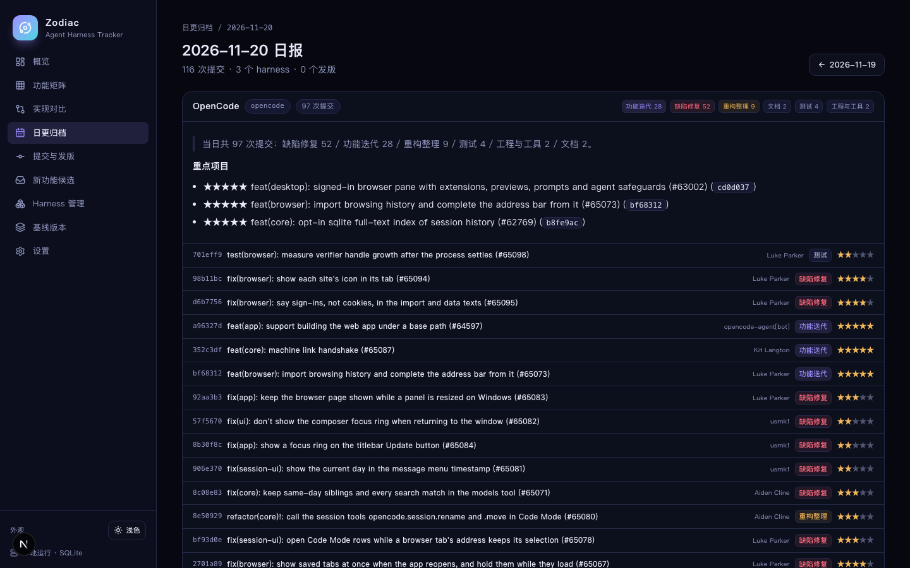
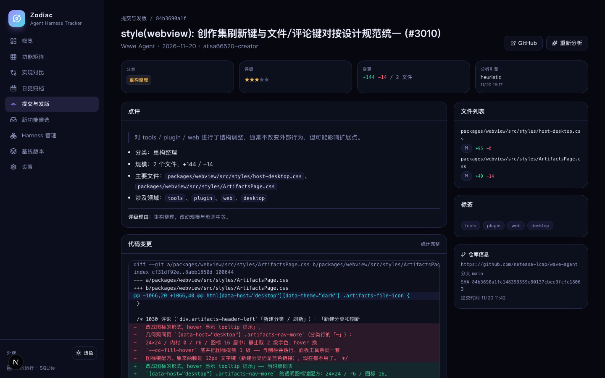
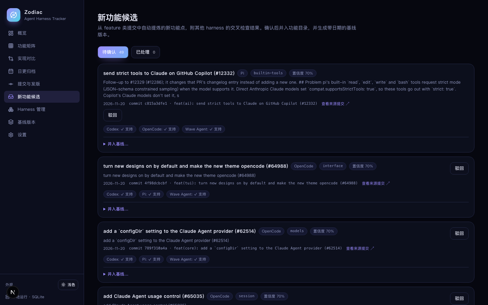
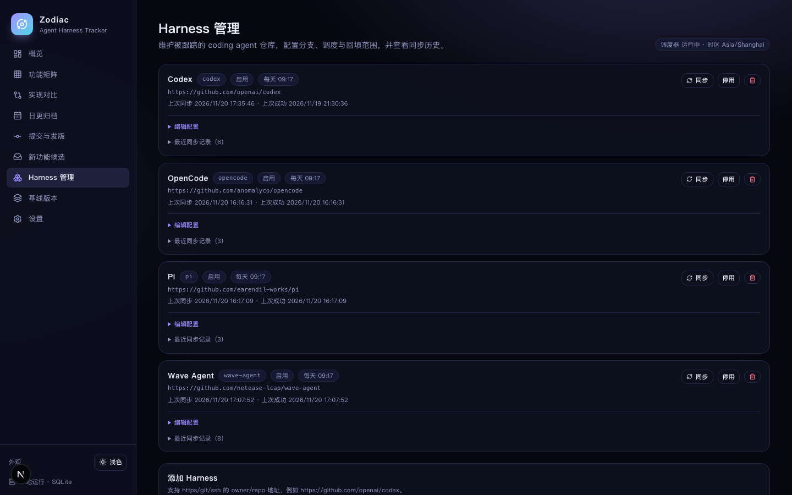
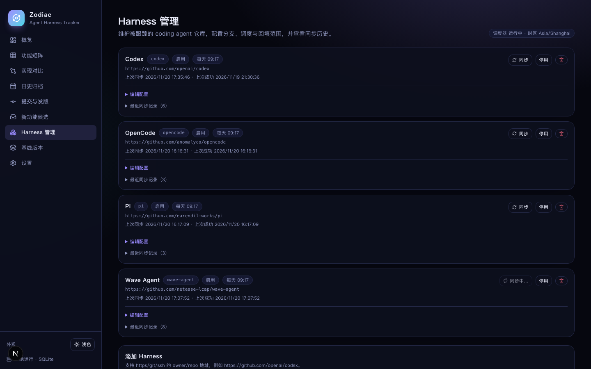

# Zodiac 功能使用指南

Zodiac 用来持续跟踪主流 coding agent harness（Codex、OpenCode、Pi、Wave Agent）的提交与发版，并把「功能矩阵 + 实现细节对比」沉淀成可回溯、可导出的基线。

本文按页面逐一说明每个功能怎么用、每个状态是什么意思。文中的截图均来自本地示例库（深色主题，数据截至 2026-11-20）。

## 目录

- [1. 快速上手](#1-快速上手)
- [2. 概览](#2-概览)
- [3. 功能矩阵](#3-功能矩阵)
- [4. 实现细节对比](#4-实现细节对比)
- [5. 功能探索](#5-功能探索)
- [6. 日更归档](#6-日更归档)
- [7. 提交与发版](#7-提交与发版)
- [8. 新功能候选](#8-新功能候选)
- [9. Harness 管理](#9-harness-管理)
- [10. 基线版本](#10-基线版本)
- [11. 设置](#11-设置)
- [12. 同步机制与运行状态](#12-同步机制与运行状态)
- [13. 常见问题](#13-常见问题)
- [附录：常用命令](#附录常用命令)

---

## 1. 快速上手

```bash
pnpm install
pnpm seed     # 导入 seed/baseline.json：4 个 harness、85 个功能点、48 段实现细节
pnpm dev      # http://localhost:3000
```

打开页面后，数据来自本地 SQLite（`data/zodiac.db`）。

**第一次同步**有两种方式：

1. 打开「Harness 管理」页，在任一 harness 卡片上点「同步」；或在概览页点「立即跟进全部」。
2. 命令行：`pnpm sync --all`，或 `pnpm sync --harness codex`。

首次同步会为每个仓库创建 bare mirror 并按「回填天数」拉取历史提交，仓库越大耗时越长。后续同步只增量抓取 `lastSha..HEAD`。

**自动同步**由应用内调度器完成（每 60 秒检查一次到期情况）：在 Harness 管理里把调度设为「每小时」或「每天 HH:MM」即可。设置 `ZODIAC_SCHEDULER=off` 可完全关闭自动同步。

---

## 2. 概览



概览页是每天打开系统时的入口。

**顶部指标卡**：跟踪的 harness 数（含启用数）、近 7 日提交数、待确认的新功能候选数、平均功能覆盖率。

**Harness 卡片**（每个仓库一张）：显示仓库地址、近 7 日与累计提交、最后同步时间、调度配置与最近一次错误。

- 「跟进」按钮只同步这一个 harness。同步期间按钮变为「同步中…」，完成后显示「已完成」，失败显示「重试」。
- 若该 harness 正在同步（包括其它页面/进程触发的），卡片上会出现「排队中/同步中」标签，「最后同步」替换为「本次同步 · 进行中…」。
- 点「管理 →」跳转到该 harness 的配置。

**「立即跟进全部」**：一次同步所有启用的 harness。按钮会按每个 run 的实时状态轮询，全部结束后自动刷新页面数据。

**下方区块**：

- 「近 14 天提交」柱状图，每根柱子可点进对应日期的日报。
- 「最近提交」和「最近发版」，点标题进入提交详情；发版来自 GitHub Releases（失败回退到 git tags）。
- 「同步运行」列出最近 6 次同步的状态、触发来源、阶段与新增数量。

没有任何数据时，页面会提示去 Harness 管理或运行 `pnpm seed`。

---

## 3. 功能矩阵



按模块（13 个）维护 85 个功能点在各 harness 上的支持状态。

**状态图例**：

| 标记       | 含义                           |
| ---------- | ------------------------------ |
| ✓ 支持     | 已实现且行为完整               |
| ◐ 部分支持 | 部分实现、有条件支持或实现有限 |
| ✗ 不支持   | 明确未实现                     |
| ? 待确认   | 尚未核实                       |

**筛选**（通过 URL 参数，可收藏/分享）：

- 搜索框：匹配功能点名称、key 或描述，例如 `compaction`、`沙箱`。
- 模块下拉：只看某个模块。
- 「仅看差异」：只保留各 harness 状态不完全一致的行，快速定位差异化能力。
- 「筛选」重新提交查询，右上角「当前筛选」会显示命中行数。

**覆盖度标签**：筛选结果上方显示每个 harness 的覆盖率（支持 + 部分支持的占比）。

**进入对比**：点击功能点名称（或任一状态徽标）进入该功能的实现细节对比页；标有「深挖」的是 12 个有实现级对比的核心功能。

---

## 4. 实现细节对比

### 4.1 对比索引



按模块汇总所有功能点，一行一个功能点、一列一个 harness，悬停状态徽标可看到该 harness 的备注。点击整行进入详情。

### 4.2 单个功能对比



- **横向差异**：该功能的总览与各 harness 差异总结（Markdown 渲染）。
- **每个 harness 一张卡**：支持状态、更新日期、支持说明、实现细节、源码「证据」路径。支持状态徽标可点击跳到 Harness 管理的对应仓库。
- **编辑支持状态**（折叠区）：选择 harness、状态、备注与证据路径，保存后会立即生成一个带日期的基线版本。这里也是人工校正自动分析结果的地方。
- **变更时间线**：该功能的历史变更记录。
- **上一/下一功能点**：按目录顺序浏览。

> 支持状态由人工确认后写入 `feature_support`，每次保存都会产生新基线版本。

### 4.3 AI 重审功能点

对比页顶部的「AI 重审功能点」会按需重审**当前这一个功能点**：模型读取每个 harness 的代码快照，重新判断支持状态、整理实现细节，并重写横向差异总结。

- **引擎自动选择**：优先 Anthropic API（按功能名称、描述、标签检索镜像中的代码片段作为证据）；未配置或失败时回退本地 Claude Code CLI（只读受限模式 + 临时 worktree 快照，可完整浏览代码）。
- **直接写入 + 新基线**：成功后覆盖该功能点的 `overview_md` / `diff_summary_md`、每个 harness 的 `feature_support`（状态、备注、证据）与 `feature_details`（实现细节），并生成一个新的带日期基线版本；需要回滚时可在「基线版本」页对照历史版本与快照 JSON。
- **可核对**：模型提交的每条证据（`path:line`）都会回到镜像逐一验证，不存在或行号越界的引用会被丢弃；页面可展开「最近一次重审报告」查看每个 harness 的结论与证据。
- **只处理有本地镜像的 harness**：尚未同步的仓库会被跳过，不会把旧状态误判为「不支持」。
- **并发限制**：同一时间只允许一个重审任务；运行中可离开页面，返回后进度会继续轮询。

> AI 重审会直接覆盖人工填写的内容（基线版本可回溯）。若模型证据不足，它会给出 `unknown` 而不是强行下结论。

---

## 5. 功能探索

输入一个命题，让系统到各 harness 的代码里找证据，生成跨 harness 的对比报告并保存下来。

**发起探索**：

1. 在「命题」里写下想比较的问题，例如「各 harness 如何处理长程任务？」「子智能体的工具权限如何隔离？」。中文或英文均可，5–600 字符。
2. 在「探索范围」中选择 harness，默认勾选全部启用的 harness；也可以只选其中几个做局部对比。
3. 点「开始探索」。页面跳转到详情页，状态依次为「AI 探索中」→「已完成」（没有可用 AI 引擎时显示「检索中」），每 2 秒自动刷新，完成后直接展示报告。

同一时间只允许一条探索在运行，重复提交会提示等待它完成。

**选择探索引擎**：在「设置 → 功能探索引擎」中选择：

- **Anthropic API（默认）**：需要 `ANTHROPIC_API_KEY` 并启用「Claude 增强分析」，由 Claude 通过应用内置的只读工具循环探索。
- **本地 Claude Code CLI**：直接调用本机已安装并登录的 `claude` 命令（默认命令名 `claude`，也可填绝对路径），不消耗 `ANTHROPIC_API_KEY`。设置页会显示该命令是否可用及版本号。

本地模式下，系统把选中 harness 的当前分支 HEAD 检出到系统临时目录的 detached worktree 快照，然后以 `--print` 无头模式运行一次 Claude Code：

- 仅开放 `Read / Grep / Glob` 三个只读工具，并启用 `--restricted`、`--safe-mode`、`--strict-mcp-config`：禁止执行命令（Bash/Write/Edit 等）、忽略项目 `CLAUDE.md`、用户/项目设置、skills、hooks 与 MCP，不会继承本仓库的 Agent 配置。
- 快照是只读检查点；运行结束后 worktree 与临时目录会被删除，不会修改 mirror。
- Claude Code 返回结构化 JSON（`--json-schema`），其中引用的文件与行号会回到 git 对象中逐一校验：越界路径、不存在的文件与越界行号会被丢弃，只保留可验证的 `path:line` 证据。
- 单次探索总时长上限约 5 分钟；超时、未登录、输出无法解析等失败都会回退到离线检索，探索本身不会失败。

**API 自主探索**：配置 `ANTHROPIC_API_KEY` 并启用「Claude 增强分析」后，由 Claude 自己决定去哪里、搜什么，而不是依赖固定的关键词表：

- Claude 通过三个只读工具浏览本地 bare mirror：`list_dir` 查看目录结构、`grep_code` 做大小写不敏感的字面检索、`read_file` 阅读带行号的代码。路径必须来自前一步的结果，越界路径会被拒绝。
- 每步最多 6 个工具调用，最多 12 步；Claude 会先广后深，把命中的文件、行与阅读内容记录为证据，最后按实际看到的 `path:line` 整理出每个 harness 的完整实现方案与横向对比。
- 检索词由 Claude 按命题语义临场决定（例如「长程任务」可能探索 todo、checkpoint、plan、background、resume 等不同实现），实际使用过的检索词会显示在报告中。
- 命题、代码与注释一律作为不可信数据提供给模型，其中看似指令的文字不会被当作指令执行；工具调用有轮次、结果长度与文件读取上限。

**离线检索（两种 AI 引擎均不可用，或 AI 调用失败时）**：系统会回退到启发式检索词与 `git grep`：

- 英文 token（去掉 how / what / handle 等停用词）直接作为检索词；中文按内置领域词典转换成英文代码术语（上下文→context、压缩→compact、沙箱→sandbox 等），中文原词也会保留。
- 若命题命中功能目录，会把相关功能点及其标签加入检索词，并在报告中显示这些功能点在各 harness 的支持状态。
- 最多 8 个检索词；全部无法提取时退化为命题原文的前 60 个字符。
- 检索在本地 mirror 上执行 `git grep`（固定字符串、不执行仓库中的任何代码），每个 harness 取当前分支 HEAD；命中文件按检索词区分度（IDF）排序，跳过噪声目录、二进制与 lockfile，文件数、片段数与输出行数都有上限。

**报告内容**：报告是主要交付物，代码只用于溯源。

- **结论**：3–8 句，直接回答命题并点出各 harness 的核心差异；未配置 AI 时为启发式摘要（命中概览、主要目录、未参与检索的 harness）。
- **横向对比**：多个 harness 时，对比设计思路、触发时机、关键数据结构、失败处理、复杂度与适用场景；随后附探索状态/命中的元数据表。
- **各 harness 实现方案**：用 Markdown 小标题组织完整方案——方案概述、核心机制与数据流、关键模块（内联 `path:line`）、边界与失败处理、取舍与局限。报告内不粘贴代码块，只保留「代码引用」路径与行号。
- **代码证据**：详情页下方默认折叠，可按 harness 展开查看原始代码片段，供逐条溯源。
- **检索说明**：实际检索词、版本、截断提示与报告的能力边界。

没有可用的 AI 引擎（或本次调用失败回退到离线检索）时，报告开头会明确标注「本次未运行 AI 分析」，此时只有代码命中位置，没有实现方案分析；启用 AI 后重新探索即可获得完整方案。

**引擎与回退**：报告顶部会标注引擎——「Claude 自主探索」（API 工具循环成功）、「本地 Claude Code 探索」（本地 CLI 成功并返回可验证引用）、「启发式 + Claude」（AI 探索失败后回退检索并由 Claude 综合）、「启发式」（完全离线）。AI 超时、网络错误、CLI 未登录或输出无法解析时自动回退，探索本身不会因此失败。代码片段被视为不可信数据，Claude 被要求只引用实际看到的内容、不编造路径与行号。

**状态说明**：

| 状态   | 含义                                                  |
| ------ | ----------------------------------------------------- |
| 运行中 | 正在 AI 探索、检索或综合；详情页每 2 秒轮询并自动刷新 |
| 已完成 | 报告与证据已保存，可随时回看                          |
| 失败   | 记录失败原因，多由检索链路异常导致                    |

单个 harness 不可用不会导致整次探索失败：镜像未同步、分支不存在或 harness 已被删除都会在证据中标注，报告仍会生成。

**历史与删除**：`/explore` 列出最近 30 条探索（命题、范围、引擎、检索词与时间）。详情页右上角可删除非运行中的记录；删除 harness 不会删除已有探索报告，报告中会保留「已删除的 harness」条目。

---

## 6. 日更归档



把每天的提交、分类统计与发版聚合成可回溯的日报。

- 顶部统计：归档天数（最多展示 90 天）、归档提交总数、跟踪的 harness 数。
- 「今天」直接跳到当天日报。
- 「近 30 天提交趋势」：点击柱子进入当天日报。
- 归档列表：每天的提交数，以及有几个 harness 当天有提交。

### 6.1 某一天的日报



- 每个 harness 一个区块：分类计数标签（如「功能迭代 3」「缺陷修复 5」）、自动生成的日报摘要、当日提交明细（点标题进提交详情）。
- 「当日发版」列出当天发布的版本。
- 顶部「前一/后一天」可连续浏览。
- 日报会在每次同步后自动重建，不需要手动维护。

---

## 7. 提交与发版


页签分为「提交」和「发版」。

**提交页签**

- 筛选：标题/正文/SHA 搜索、Harness、分类（功能迭代、性能优化、缺陷修复、重构整理、文档、测试、工程与工具、其他）、起止日期；「重置」清空筛选。
- 列表每页 40 条，显示分类、1–5 星评级、增删行数、文件与分析引擎（启发式 / Claude API / 本地 Claude Code）。
- 未分析的提交分类显示为「未分析」。

**发版页签**

- 最近 100 条发版记录，含 tag、名称、发布日期与外链；有正文时可展开查看 Markdown 说明。

### 7.1 提交详情



- 顶部「GitHub」外链到原始提交；「重新分析」会重新生成分类、评级与评审：优先使用 Anthropic API，未配置或调用失败时自动回退本地 Claude Code CLI，仍不可用则使用启发式规则。分析在后台执行，按钮每 2 秒轮询进度；分析中刷新页面会继续显示「分析中…」并接上同一次任务，重复点击不会启动第二次分析。
- 四张卡：分类、评级、变更规模、分析引擎与时间。
- 「评审与代码解读」：像 code review 一样分四节说明——「解决的问题」「具体改动」（最多 3–5 条，只点关键文件与核心函数）「实现解读」（3–5 步讲清思路与执行流程，只引用几个关键函数）「影响与风险」，并给出评级理由。正文通常 300–600 字，不逐文件、逐函数、逐行翻译 diff；diff 较长时以截断摘录分析并注明盲区。评级依据功能重要性、影响面与风险，改动行数不作为加分项。
- 分析引擎标记：「启发式」（仅依据提交信息与文件清单，未读取 diff）、「Claude API」（Anthropic API 评审）、「本地 Claude Code」（本机 `claude` CLI 评审）。
- 「代码变更」：标注统计是否完整；diff 超过 1500 行会截断显示。
- 侧栏：文件列表（状态与增删）、功能标签、仓库信息（分支、SHA、提交时间）。

---

## 8. 新功能候选



同步时，系统会从 feature 类提交中提炼「新功能候选」，并对其它 harness 做交叉检查（目录相似度 + 提交历史）。人工确认后才会进入功能矩阵与基线。

**候选卡片**：标题、来源 harness、模块、置信度、描述、创建日期、来源提交链接，以及其它 harness 的交叉检查结果（例如「Codex: ✓ 支持」）。

- **驳回**：直接丢弃该候选（无二次确认）。
- **并入基线…**（展开）：
  1. 功能点 key（默认 `模块key.slug`，必须符合 `模块.功能` 形式）；
  2. 名称；
  3. 模块；
  4. 每个 harness 的支持状态（默认取交叉检查结果，来源 harness 默认 ✓，其余默认 ?）；
  5. 写入来源 harness 支持说明的备注。
- 点「确认并入基线」后，至少要为 1 个 harness 选择非「?」状态。成功后提示新的基线版本号，候选移到「已处理」。

---

## 9. Harness 管理



管理被跟踪的仓库及其调度配置。页头显示调度器是否运行和当前时区。

**卡片操作**：

- 「同步」：立即同步该仓库，并轮询显示进度；完成后提示新增提交数。
- 「停用/启用」：不删除数据，只停止自动同步。
- 垃圾桶按钮：删除 harness，会级联删除提交、发版、同步记录、候选与支持记录，并清理本地镜像。有确认框，不可撤销。

**编辑配置**（折叠区）：

| 字段     | 说明                                 |
| -------- | ------------------------------------ |
| 名称     | 显示名                               |
| 仓库地址 | 支持 https / git / ssh 的 owner/repo |
| 分支     | 默认 `main`                          |
| 调度     | 关闭 / 每小时 / 每天                 |
| 每日时刻 | 调度为「每天」时的时间（如 09:17）   |
| 回填天数 | 1–3650，首次同步向前抓取的范围       |
| 排序     | 概览与列表中的展示顺序               |

**调度规则**：

- 关闭：不自动同步。
- 每小时：距上次尝试满 55 分钟即到期。
- 每天：在配置时区的每日时刻之后、且当天尚未尝试过时到期。

由于判断依据是「上次尝试开始时间」而不是完成时间，一次很长的同步不会被重复触发。

**最近同步记录**（折叠区）：每次同步的状态、开始时间、触发来源（`manual`/`schedule`/`cli`）、阶段与新增数量，失败时显示错误信息，是排查问题的第一入口。

**添加 Harness**：表单填 slug、名称、仓库地址、分支、调度、每日时刻与回填天数（默认 30），点「添加 Harness」。

### 9.1 同步进行中



同步开始后，按钮进入「同步中…」并禁用；进度通过每 2 秒一次的状态查询更新。刷新页面不会丢掉进度：服务端会把正在运行的 run 交给按钮，重新挂载后继续轮询。

---

## 10. 基线版本


功能目录的每次变更都会生成一个带日期、不可变的快照；人工保存支持状态与「AI 重审功能点」都会产生新版本。

- **统计卡**：当前基线版本号、版本总数、功能点数、支持记录数。
- **当前基线**：生成时间、版本说明，以及当时各 harness 的提交 SHA（未同步显示「未同步」）。
- **版本时间线**：最近 60 个版本及其功能点/支持记录数量、说明与各仓库 SHA。
- **功能变更记录**：最近 40 条功能状态变更，可点进对比页。

**版本号规则**：以日期 `YYYY-MM-DD` 命名；同一天多次变更依次为 `YYYY-MM-DD-2`、`YYYY-MM-DD-3`……

**导出**：

- 「导出 Markdown」→ `GET /api/baseline/export?format=md`，下载 `zodiac-baseline-{day}.md`。
- 「导出 JSON」→ `GET /api/baseline/export`，下载 `zodiac-baseline-{day}.json`，包含 modules / features / support 完整快照、生成时间与各 harness SHA。

---

## 11. 设置


**可编辑项**：

| 设置                   | 说明                                                                          |
| ---------------------- | ----------------------------------------------------------------------------- |
| 启用 Claude 增强分析   | 需要配置 `ANTHROPIC_API_KEY`；关闭时提交评审直接使用本地 Claude Code 或启发式 |
| 模型                   | 默认 `claude-sonnet-5`，可被环境变量 `ANTHROPIC_MODEL` 或此处保存值覆盖       |
| 每次同步的 AI 分析上限 | 0–200，默认 20；0 表示不调用 AI，超出部分仍走启发式                           |
| 时区（按天归档）       | 影响按天归档与每日调度；保存后写入数据库并作用于当前进程                      |
| 探索引擎               | 「Anthropic API」或「本地 Claude Code CLI」；决定功能探索由谁执行             |
| Claude Code 命令       | 本地模式的命令名或绝对路径，默认 `claude`；不经过 shell                       |

提交评审的模型调用（API 或本地 Claude Code）计入「每次同步的 AI 分析上限」，并有超时保护；两者都不可用时自动回退启发式，不会中断同步。功能探索在 API 自主探索模式下最多约 13 次模型调用（12 步工具循环 + 1 次报告生成），不受同步条数上限约束；本地 Claude Code 模式按 CLI 自身的额度与权限运行，单次约 5 分钟超时；回退到离线检索后最多调用一次 AI 综合。

**右侧「环境状态」**：直观显示 `ANTHROPIC_API_KEY`、AI 分析、功能探索引擎、本地 Claude Code（命令与版本）、后台调度器、`GITHUB_TOKEN` 的配置情况。

**只能通过环境变量控制的项**：

- `ZODIAC_SCHEDULER=off`：关闭应用内调度器（表单里没有开关）。
- `ZODIAC_DB_PATH`：SQLite 文件位置。
- `ZODIAC_TZ`：默认归档时区（表单修改只在当前进程生效，重启后以环境变量为准）。
- `ZODIAC_LOCAL_CLAUDE=off`：禁用提交评审的本地 Claude Code 回退（例如不希望同步时启动本机 CLI）。

密钥只从环境变量读取，不会写入数据库或页面。

---

## 12. 同步机制与运行状态

一次同步分为两个阶段：

1. **预约**：先创建一条运行中的 run 记录并立刻返回 run id，页面可以马上开始轮询。
2. **执行**：抓取 → 入库 → 分析 → 重建日报 → 候选交叉检查，阶段依次为 `fetch` → `ingest` → `analyze` → `finalize` → `done`。

运行期间：

- 每次阶段切换都会更新状态；同时每 30 秒刷新一次心跳，用来区分「还在跑」和「进程已退出」。
- 进程崩溃或重启后留下的运行记录，只有心跳超过 5 分钟未更新才会被回收为失败；应用不会把正常的长同步误判为孤儿。
- 同一个 harness 同时只会有一个运行中的同步；重复触发会返回「已有同步正在进行」并附上现有 run 的 id。

**触发来源**：手动（页面按钮）、定时（调度器）、命令行（`pnpm sync`）。

---

## 13. 常见问题

**首次同步很慢？**
首次会按回填天数拉取历史提交并逐条分析，取决于仓库大小与网络。之后是增量同步。

**同步失败怎么看原因？**
打开 Harness 管理 →「最近同步记录」查看错误信息；卡片上的红色错误条也会显示最近一次失败。常见原因是网络中断导致 `git fetch` 失败，重新点「同步」即可。

**发版列表为空 / 提示 GitHub API 403？**
未配置 `GITHUB_TOKEN` 时使用匿名访问，容易触发限流。系统会自动回退到 git tags；配置 token 后重启即可恢复 Releases 数据。

**想重算历史提交的分析结果？**

```bash
pnpm reanalyze                  # 用最新启发式规则重算全部提交
pnpm reanalyze --harness codex  # 只重算某个 harness
pnpm reanalyze --reset-candidates  # 先清空待审候选再重算
```

**数据存在哪里？**
SQLite 在 `data/zodiac.db`，bare mirror 在 `data/mirrors/`，按需落盘的 diff 在 `data/diffs/`。这些目录默认被 git 忽略。

**Markdown 会执行 HTML 吗？**
不会。点评、日报与对比内容默认不渲染原始 HTML。

---

## 附录：常用命令

```bash
pnpm dev                    # 开发服务器
pnpm build && pnpm start    # 生产构建
pnpm sync --all             # 同步全部启用的 harness
pnpm sync --harness codex   # 同步单个 harness
pnpm seed                   # 导入基线数据
pnpm build-baseline         # 由 seed/parts/*.json 重新生成 seed/baseline.json
pnpm reanalyze              # 重算历史分析
pnpm lint / pnpm typecheck / pnpm test / pnpm e2e
```
